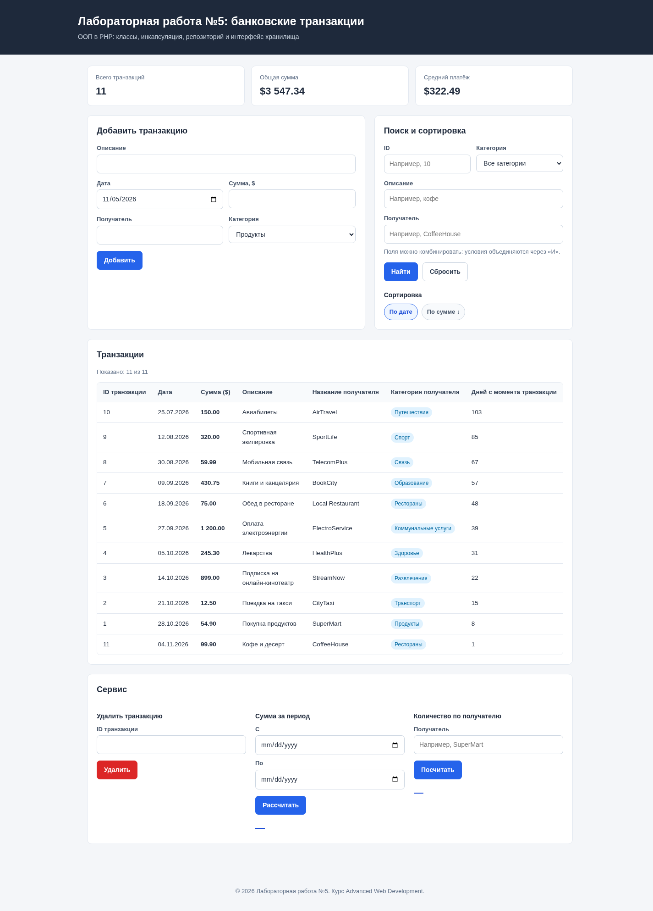
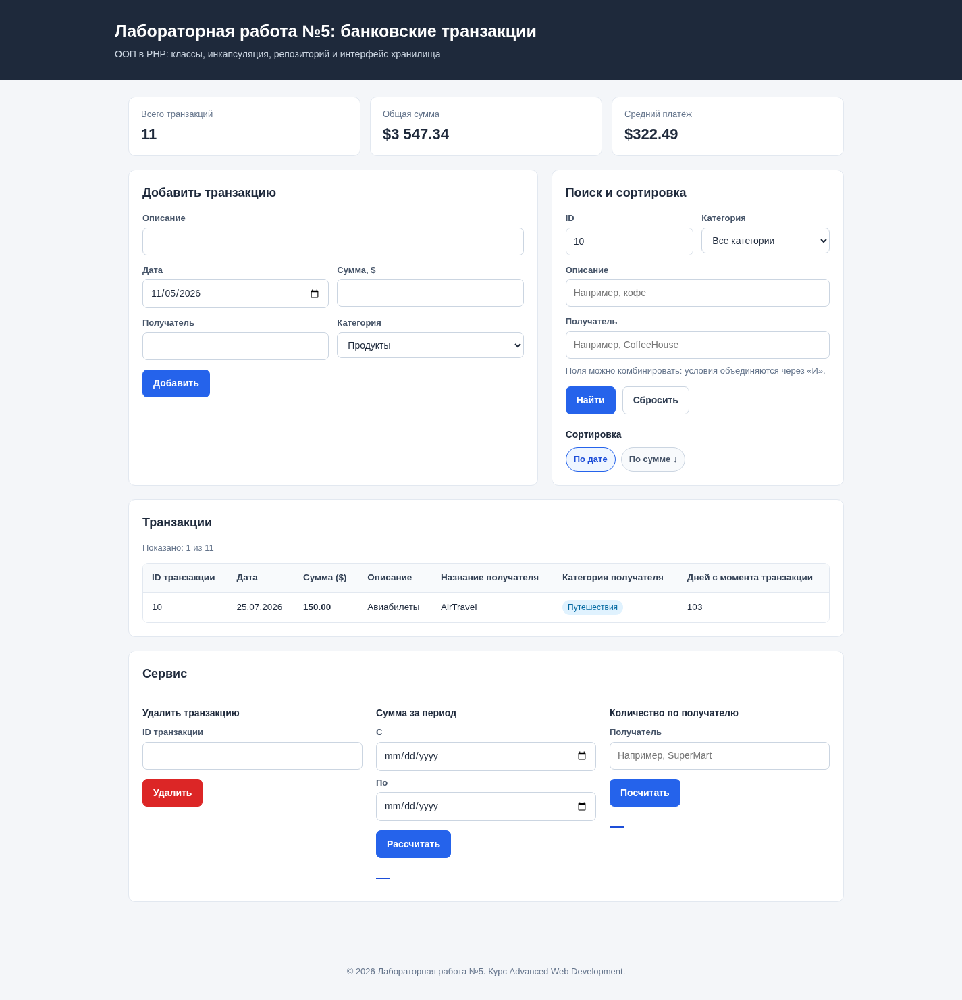
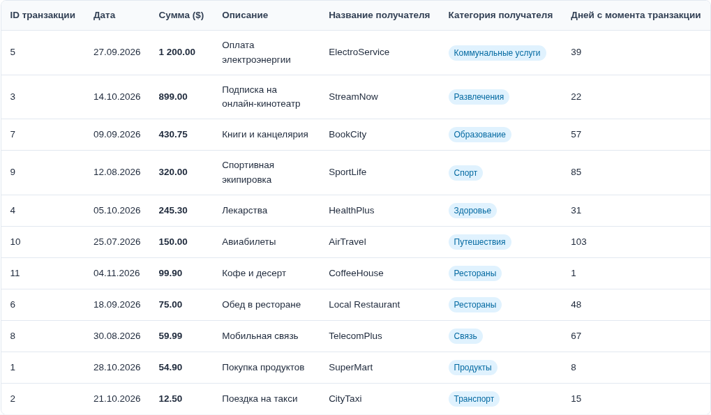
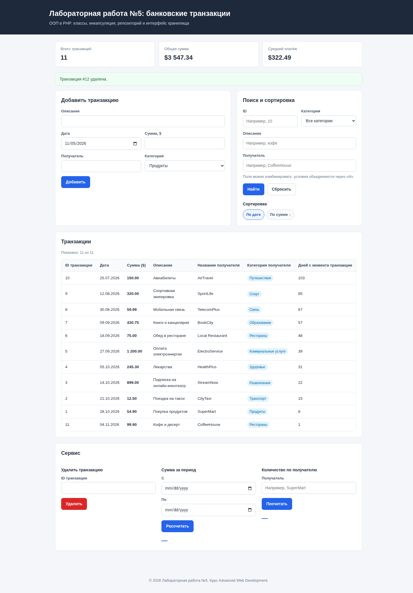

# Лабораторная работа №5: Объектно-ориентированное программирование в PHP

## Цель работы

Освоить основы объектно-ориентированного программирования в PHP на практике: научиться создавать собственные классы, использовать инкапсуляцию для защиты данных, разделять ответственность между классами и применять интерфейсы для построения гибкой архитектуры приложения.

---

## Структура проекта

Классы вынесены в отдельные файлы, чтобы наглядно разделить зоны ответственности:

```text
lab5/
├── index.php
├── data.json
├── main.md
├── image.png
├── image-1.png
├── image-2.png
├── image-3.png
└── src/
    ├── Transaction.php
    ├── TransactionStorageInterface.php
    ├── TransactionRepository.php
    ├── TransactionManager.php
    └── TransactionTableRenderer.php
```

`index.php` выполняет роль контроллера: принимает POST-запросы, вызывает сервисы и выводит страницу. Коллекция транзакций хранится в `data.json`, поэтому добавления и удаления сохраняются между запросами.

---

## Задание 1. Включение строгой типизации

В каждом PHP-файле проекта включён режим строгой типизации:

```php
<?php

declare(strict_types=1);
```

Директива действует на файл, в котором объявлена, поэтому она добавлена не только в `index.php`, но и во все файлы классов. Это заставляет PHP проверять типы аргументов и возвращаемых значений без неявного приведения, например, не позволяет передать строку `"100"` туда, где ожидается `int`.

---

## Задание 2. Класс Transaction

Класс `Transaction` описывает одну банковскую транзакцию. Все свойства объявлены приватными, доступ к ним возможен только через getter-методы. Дополнительно добавлено свойство `category` — оно необходимо для столбца «Категория получателя» в итоговой HTML-таблице.

Ключевые фрагменты класса:

```php
final class Transaction
{
    private int $id;
    private DateTime $date;
    private float $amount;
    private string $description;
    private string $merchant;
    private string $category;

    public function __construct(
        int $id,
        string $date,
        float $amount,
        string $description,
        string $merchant,
        string $category
    ) {
        // Проверка ID, даты, суммы и непустых строковых полей...
        $this->id = $id;
        $this->date = $parsedDate;
        $this->amount = $amount;
        $this->description = $description;
        $this->merchant = $merchant;
        $this->category = $category;
    }

    public function getId(): int
    {
        return $this->id;
    }

    public function getDate(): DateTime
    {
        // Возвращается копия, чтобы внешний код не изменил внутреннее состояние.
        return clone $this->date;
    }

    public function getAmount(): float
    {
        return $this->amount;
    }

    public function getDescription(): string
    {
        return $this->description;
    }

    public function getMerchant(): string
    {
        return $this->merchant;
    }

    public function getCategory(): string
    {
        return $this->category;
    }

    public function getDaysSinceTransaction(): int
    {
        $interval = $this->date->diff(new DateTime('today'));

        return (int) $interval->format('%r%a');
    }
}
```

Для сохранения в JSON добавлены методы `toArray()` и `fromArray()`. Категория — обычная строка; список вариантов задаётся в форме добавления.

Для работы с датами используется `DateTime`. Дата принимается строкой в формате `YYYY-MM-DD`, проверяется через `DateTime::createFromFormat()` и хранится внутри объекта. Метод `getDaysSinceTransaction()` возвращает количество дней от даты операции до текущего дня; для будущих дат результат будет отрицательным.

---

## Задание 3. Класс TransactionRepository

`TransactionRepository` хранит массив объектов `Transaction` и отвечает только за базовые операции доступа. Массив объявлен приватным, снаружи к нему обратиться нельзя.

```php
final class TransactionRepository implements TransactionStorageInterface
{
    /** @var Transaction[] */
    private array $transactions = [];

    public function __construct(
        private string $filePath
    ) {
        if (is_file($this->filePath)) {
            $rows = json_decode((string) file_get_contents($this->filePath), true);

            if (is_array($rows)) {
                foreach ($rows as $row) {
                    if (is_array($row)) {
                        $this->transactions[] = Transaction::fromArray($row);
                    }
                }
            }
        }
    }

    public function addTransaction(Transaction $transaction): void
    {
        if ($this->findById($transaction->getId()) !== null) {
            throw new InvalidArgumentException('Транзакция с таким ID уже существует.');
        }

        $this->transactions[] = $transaction;
        $this->save();
    }

    public function removeTransactionById(int $id): void
    {
        foreach ($this->transactions as $index => $transaction) {
            if ($transaction->getId() === $id) {
                unset($this->transactions[$index]);
                $this->transactions = array_values($this->transactions);
                $this->save();

                return;
            }
        }
    }

    /** @return Transaction[] */
    public function getAllTransactions(): array
    {
        return $this->transactions;
    }

    public function findById(int $id): ?Transaction
    {
        foreach ($this->transactions as $transaction) {
            if ($transaction->getId() === $id) {
                return $transaction;
            }
        }

        return null;
    }

    public function getNextId(): int
    {
        $maxId = 0;

        foreach ($this->transactions as $transaction) {
            $maxId = max($maxId, $transaction->getId());
        }

        return $maxId + 1;
    }

    private function save(): void
    {
        $rows = array_map(
            static fn (Transaction $transaction): array => $transaction->toArray(),
            $this->transactions
        );

        $json = json_encode($rows, JSON_PRETTY_PRINT | JSON_UNESCAPED_UNICODE);

        if ($json === false || file_put_contents($this->filePath, $json . PHP_EOL) === false) {
            throw new RuntimeException('Не удалось сохранить транзакции в файл.');
        }
    }
}
```

При добавлении проверяется уникальность ID: повторная вставка вызывает `InvalidArgumentException`. Удаление несуществующего ID безопасно — коллекция просто не меняется. Конструктор загружает `data.json` через `json_decode()`, а метод `save()` сохраняет коллекцию в читаемом JSON. `getNextId()` вычисляет следующий идентификатор как максимальный существующий + 1.

---

## Задание 4. Класс TransactionManager

`TransactionManager` содержит бизнес-логику и не хранит транзакции самостоятельно. В конструктор передаётся хранилище, соответствующее интерфейсу `TransactionStorageInterface`:

```php
public function __construct(
    private TransactionStorageInterface $repository
) {
}
```

Реализованные методы:

- `calculateTotalAmount(): float` — суммирует `getAmount()` всех транзакций из репозитория;
- `calculateTotalAmountByDateRange(string $startDate, string $endDate): float` — суммирует операции за период включительно; даты проверяются, конец периода расширяется до `23:59:59`;
- `countTransactionsByMerchant(string $merchant): int` — считает количество операций по получателю без учёта регистра;
- `sortTransactionsByDate(): Transaction[]` — возвращает новый массив, отсортированный по дате от старых к новым;
- `sortTransactionsByAmountDesc(): Transaction[]` — сортирует по сумме по убыванию.

Пример вычисления суммы за период:

```php
public function calculateTotalAmountByDateRange(string $startDate, string $endDate): float
{
    $start = new DateTime($startDate);
    $end = new DateTime($endDate);
    $end->setTime(23, 59, 59);

    if ($start > $end) {
        throw new InvalidArgumentException('Начальная дата не может быть позже конечной.');
    }

    $total = 0.0;

    foreach ($this->repository->getAllTransactions() as $transaction) {
        $transactionDate = $transaction->getDate();

        if ($transactionDate >= $start && $transactionDate <= $end) {
            $total += $transaction->getAmount();
        }
    }

    return $total;
}
```

Сортировка по дате:

```php
public function sortTransactionsByDate(): array
{
    $transactions = $this->repository->getAllTransactions();

    usort(
        $transactions,
        static fn (Transaction $a, Transaction $b): int => $a->getDate()->getTimestamp() <=> $b->getDate()->getTimestamp()
    );

    return $transactions;
}
```

Методы не изменяют исходный массив репозитория: `getAllTransactions()` возвращает копию массива, а `usort()` работает уже с ней.

---

## Задание 5. Класс TransactionTableRenderer

`TransactionTableRenderer` объявлен как `final` и отвечает только за формирование HTML. Метод `render(array $transactions): string` возвращает готовую таблицу со столбцами:

1. ID транзакции;
2. дата;
3. сумма;
4. описание;
5. название получателя;
6. категория получателя;
7. количество дней с момента транзакции.

```php
final class TransactionTableRenderer
{
    /** @param Transaction[] $transactions */
    public function render(array $transactions): string
    {
        $rows = '';

        foreach ($transactions as $transaction) {
            if (!$transaction instanceof Transaction) {
                throw new InvalidArgumentException('Массив должен содержать только объекты Transaction.');
            }

            $rows .= sprintf(
                '<tr>'
                . '<td>%d</td>'
                . '<td>%s</td>'
                . '<td class="amount">%s</td>'
                . '<td>%s</td>'
                . '<td>%s</td>'
                . '<td><span class="category">%s</span></td>'
                . '<td>%d</td>'
                . '</tr>',
                $transaction->getId(),
                $this->escape($transaction->getDate()->format('d.m.Y')),
                number_format($transaction->getAmount(), 2, '.', ' '),
                $this->escape($transaction->getDescription()),
                $this->escape($transaction->getMerchant()),
                $this->escape($transaction->getCategory()),
                $transaction->getDaysSinceTransaction()
            );
        }

        // ...формирование секций thead/tbody и возврат строки таблицы...
    }

    private function escape(string $value): string
    {
        return htmlspecialchars($value, ENT_QUOTES | ENT_SUBSTITUTE, 'UTF-8');
    }
}
```

Все пользовательские строки экранируются через `htmlspecialchars()`, поэтому описание или название получателя с символами `<`, `>`, `&` не сломают разметку. В основном файле таблица не собирается вручную — выполняется только вызов:

```php
<?php echo $renderer->render($transactions); ?>
```

---

## Задание 6. Начальные данные

Начальная коллекция состоит из 10 транзакций с разными датами, суммами, описаниями и получателями:

| ID | Дата | Сумма ($) | Описание | Получатель | Категория |
|---:|:---|---:|:---|:---|:---|
| 1 | 28.10.2026 | 54.90 | Покупка продуктов | SuperMart | Продукты |
| 2 | 21.10.2026 | 12.50 | Поездка на такси | CityTaxi | Транспорт |
| 3 | 14.10.2026 | 899.00 | Подписка на онлайн-кинотеатр | StreamNow | Развлечения |
| 4 | 05.10.2026 | 245.30 | Лекарства | HealthPlus | Здоровье |
| 5 | 27.09.2026 | 1200.00 | Оплата электроэнергии | ElectroService | Коммунальные услуги |
| 6 | 18.09.2026 | 75.00 | Обед в ресторане | Local Restaurant | Рестораны |
| 7 | 09.09.2026 | 430.75 | Книги и канцелярия | BookCity | Образование |
| 8 | 30.08.2026 | 59.99 | Мобильная связь | TelecomPlus | Связь |
| 9 | 12.08.2026 | 320.00 | Спортивная экипировка | SportLife | Спорт |
| 10 | 25.07.2026 | 150.00 | Авиабилеты | AirTravel | Путешествия |

Стартовые 10 транзакций и добавленная #11 сохранены в `data.json` и загружаются репозиторием при каждом запросе. На странице доступны интерактивные операции:

- **добавление** — POST-форма с полями даты, суммы, описания, получателя и категории; ID присваивается автоматически;
- **удаление** — POST-форма с вводом ID транзакции;
- **поиск** — отдельные поля для ID, описания, получателя и категории; условия комбинируются через «И», поэтому ввод «10» в поле ID не ищет ещё и по тексту;
- **сортировка** — по дате и по сумме (по убыванию);
- **вычисления** — общая сумма, сумма за выбранный период и количество операций по получателю;
- **вывод** — HTML-таблица, формируемая отдельным классом `TransactionTableRenderer`.

Сообщение об успехе или ошибке выводится на той же странице. В ходе проверки была добавлена транзакция #11 «Кофе и десерт» (CoffeeHouse, 99.90 $), а временная запись #12 удалена через форму.

---

## Задание 7. Интерфейс TransactionStorageInterface

Интерфейс задаёт единый контракт хранилища:

```php
interface TransactionStorageInterface
{
    public function addTransaction(Transaction $transaction): void;

    public function removeTransactionById(int $id): void;

    /** @return Transaction[] */
    public function getAllTransactions(): array;

    public function findById(int $id): ?Transaction;
}
```

`TransactionRepository` реализует этот интерфейс:

```php
final class TransactionRepository implements TransactionStorageInterface
```

А `TransactionManager` принимает уже интерфейс, а не конкретный класс:

```php
public function __construct(
    private TransactionStorageInterface $repository
) {
}
```

Благодаря этому менеджер не знает, где именно хранятся данные. Вместо `TransactionRepository` можно передать реализацию, работающую с базой данных, файлом или удалённым API, — код `TransactionManager` при этом менять не придётся.

---

## Результат работы

После добавления тестовой транзакции #11 «Кофе и десерт» на странице 11 записей: общая сумма `3 547.34 $`, средний платёж `322.49 $`. При проверке период `01.09.2026–30.09.2026` дал `1 705.75 $`, а по получателю SuperMart найдена одна транзакция.



Поиск по ID 10 — одна транзакция (AirTravel), хотя в описании и категории цифры «10» нет:



Таблица, отсортированная по сумме по убыванию:



Удаление временной транзакции #12 через форму (в списке осталось 11 записей):



---

## Запуск проекта

```bash
php -S localhost:8000 -t lab5
```

Затем открыть в браузере `http://localhost:8000`.

Файл `data.json` должен быть доступен на запись пользователю, от имени которого работает PHP. В нём хранится текущая коллекция транзакций.

---

## Документация кода

Все классы и методы снабжены PHPDoc-блоками с описанием назначения, параметров, возвращаемых значений и исключений. Например:

```php
/**
 * Вычисляет сумму транзакций за период включительно.
 *
 * @param string $startDate Начало периода в формате YYYY-MM-DD.
 * @param string $endDate Конец периода в формате YYYY-MM-DD.
 * @return float Сумма транзакций за период.
 *
 * @throws InvalidArgumentException Если даты некорректны или начало позже конца.
 */
public function calculateTotalAmountByDateRange(string $startDate, string $endDate): float
```

Для массивов объектов используются обобщённые аннотации `@return Transaction[]` и `@param Transaction[] $transactions`, что помогает IDE и инструментам статического анализа понимать типы элементов.

---

## Контрольные вопросы

### 1. Зачем нужна строгая типизация в PHP и как она помогает при разработке?

Строгая типизация (`declare(strict_types=1);`) заставляет PHP проверять соответствие типов аргументов и возвращаемых значений объявленным типам без неявного приведения. Без неё строка `"5"` может быть молча преобразована в число `5`, а с ней будет выброшено `TypeError`.

Преимущества:

- ошибки типов обнаруживаются сразу, а не приводят к странным результатам позже;
- код становится самодокументируемым: сигнатура метода показывает, что он принимает и возвращает;
- упрощается работа IDE, статического анализа (PHPStan, Psalm) и автодополнение;
- уменьшается количество скрытых багов при рефакторинге;
- контракты классов и интерфейсов соблюдаются строже.

Важно помнить: директива действует только на файл, в котором объявлена, и не влияет на вызовы из других файлов. Поэтому её добавляют во все файлы проекта.

### 2. Что такое класс в объектно-ориентированном программировании и какие основные компоненты класса вы знаете?

Класс — это шаблон (чертёж) для создания объектов. Он описывает состояние и поведение будущих экземпляров. Объект — конкретный экземпляр класса, созданный через `new`.

Основные компоненты класса:

- **свойства** — данные, описывающие состояние объекта (`private float $amount`);
- **методы** — функции, описывающие поведение объекта (`getAmount()`, `calculateTotalAmount()`);
- **конструктор** — специальный метод `__construct()`, вызываемый при создании объекта;
- **деструктор** — `__destruct()`, вызываемый при уничтожении объекта;
- **константы класса** — неизменяемые значения (`const STATUS_ACTIVE = 'active';`);
- **модификаторы доступа** — `public`, `protected`, `private`, управляющие видимостью;
- **статические свойства и методы** — принадлежащие классу, а не конкретному объекту;
- **наследование, интерфейсы, трейты** — механизмы повторного использования и описания контрактов.

В данной работе класс `Transaction` содержит приватные свойства, конструктор и getter-методы, а класс `TransactionManager` — бизнес-методы, работающие с коллекцией.

### 3. Объясните, что такое полиморфизм и как он может быть реализован в PHP.

Полиморфизм — это возможность разных объектов по-разному выполнять один и тот же интерфейс (один и тот же вызов метода приводить к разному поведению). Клиентский код работает с общим контрактом и не зависит от конкретного класса.

В PHP полиморфизм реализуется несколькими способами:

1. **Через интерфейсы** — разные классы реализуют одни и те же методы:
   ```php
   interface TransactionStorageInterface
   {
       public function getAllTransactions(): array;
   }

   class InMemoryRepository implements TransactionStorageInterface { /* ... */ }
   class DatabaseRepository implements TransactionStorageInterface { /* ... */ }

   function printTotal(TransactionStorageInterface $storage): void
   {
       foreach ($storage->getAllTransactions() as $transaction) {
           echo $transaction->getAmount();
       }
   }
   ```
   Функция `printTotal()` работает с любым хранилищем, которое соблюдает контракт.

2. **Через наследование и переопределение методов** — дочерний класс переопределяет метод родителя:
   ```php
   class Report
   {
       public function render(): string { return 'Базовый отчёт'; }
   }

   class HtmlReport extends Report
   {
       public function render(): string { return '<h1>HTML-отчёт</h1>'; }
   }
   ```

3. **Через абстрактные классы** — родитель задаёт общий каркас, а конкретные классы реализуют абстрактные методы.

В лабораторной работе полиморфизм проявляется в том, что `TransactionManager` зависит от `TransactionStorageInterface`. Ему не важно, какой именно объект передан — `TransactionRepository`, хранилище в базе данных или тестовый mock, лишь бы он реализовывал нужные методы. Это позволяет подменять реализацию без изменения менеджера.

### 4. Что такое интерфейс в PHP и как он отличается от абстрактного класса?

Интерфейс — это контракт, который описывает, какие методы должен реализовать класс, но не содержит их реализации (в классическом понимании). Класс может реализовать несколько интерфейсов одновременно.

| Критерий | Интерфейс | Абстрактный класс |
|:---|:---|:---|
| Назначение | Контракт поведения | Общая база с частичной реализацией |
| Свойства | Не содержит состояния (только константы) | Может содержать свойства |
| Реализация методов | Не содержит (только сигнатуры) | Может содержать конкретные методы |
| Конструктор | Может объявлять сигнатуру, но не реализацию | Может содержать реализацию |
| Наследование | Класс может реализовать много интерфейсов | Класс наследует только один абстрактный класс |
| Модификаторы методов | Все методы публичные | Могут быть `public`, `protected`, `private` |
| Создание экземпляра | Невозможно | Невозможно |
| Когда использовать | Нужен независимый контракт, несколько реализаций, слабая связанность | Нужна общая логика и состояние для группы родственных классов |

В PHP класс может одновременно наследовать один абстрактный класс и реализовывать несколько интерфейсов. Интерфейс удобен, когда разные классы не связаны родством, но должны поддерживать одинаковый набор операций.

### 5. Какие преимущества дает использование интерфейсов при проектировании архитектуры приложения? Объясните на примере данной лабораторной работы.

Интерфейсы дают следующие преимущества:

- **слабая связанность (loose coupling)** — код зависит от абстракции, а не от конкретной реализации;
- **взаимозаменяемость реализаций** — можно хранить данные в памяти, базе данных, файле или API, не меняя бизнес-логику;
- **удобство тестирования** — вместо реального хранилища можно передать mock-объект с тем же интерфейсом;
- **соблюдение принципа инверсии зависимостей (DIP)** — модуль верхнего уровня (`TransactionManager`) не зависит от модуля нижнего уровня (`TransactionRepository`), оба зависят от интерфейса;
- **ясный контракт** — интерфейс документирует, что именно должен уметь класс;
- **параллельная разработка** — один разработчик может делать менеджер, другой — конкретное хранилище, договорившись об интерфейсе;
- **расширяемость** — новая реализация подключается без изменения существующего кода (принцип открытости/закрытости).

В лабораторной работе это видно наглядно:

```php
$repository = new TransactionRepository(__DIR__ . '/data.json');
$manager = new TransactionManager($repository);     // зависит от интерфейса
```

Если позже понадобится хранить транзакции в базе данных, достаточно создать, например, `DatabaseTransactionRepository implements TransactionStorageInterface` и передать его в конструктор:

```php
$manager = new TransactionManager(new DatabaseTransactionRepository($pdo));
```

`TransactionManager` при этом не изменится: он по-прежнему будет вызывать `getAllTransactions()`, `findById()` и другие методы через интерфейс. Именно это делает архитектуру гибкой и готовой к развитию.

---

## Вывод

В ходе лабораторной работы №5 я освоил объектно-ориентированный подход в PHP. Я создал класс `Transaction` с приватными свойствами, конструктором, getter-методами и вычислением количества дней через `DateTime`; класс `TransactionRepository` для хранения коллекции и базовых операций; класс `TransactionManager` для бизнес-логики (суммы, период, подсчёт по получателю, сортировки); класс `TransactionTableRenderer` для формирования HTML-таблицы. Все классы разделены по ответственности, а взаимодействие построено через интерфейс `TransactionStorageInterface`.

Я убедился, что инкапсуляция защищает данные от прямого изменения, строгая типизация помогает ловить ошибки на раннем этапе, а интерфейс позволяет заменять хранилище без переписывания менеджера. Дополнительно я задокументировал классы и методы в стандарте PHPDoc и проверил работу приложения в браузере: добавление и удаление через POST-формы, поиск по ID/описанию/получателю/категории, фильтрация, сортировка по дате и сумме, расчёт суммы за период и количества операций по получателю. Данные сохраняются в `data.json` и не теряются между запросами.
