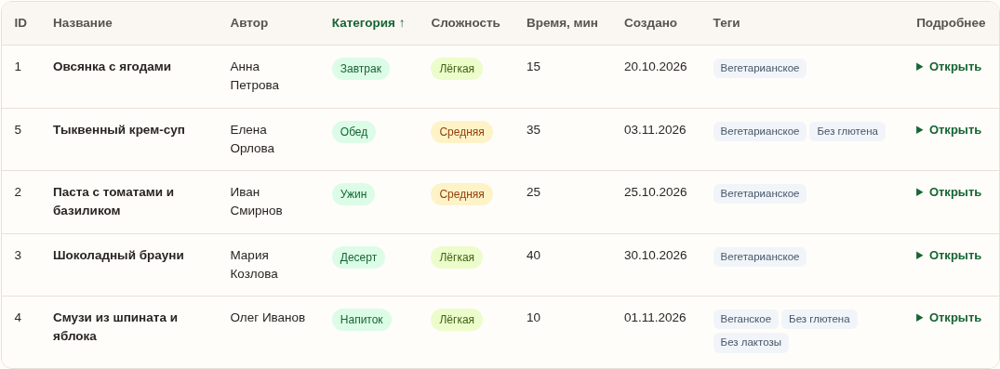
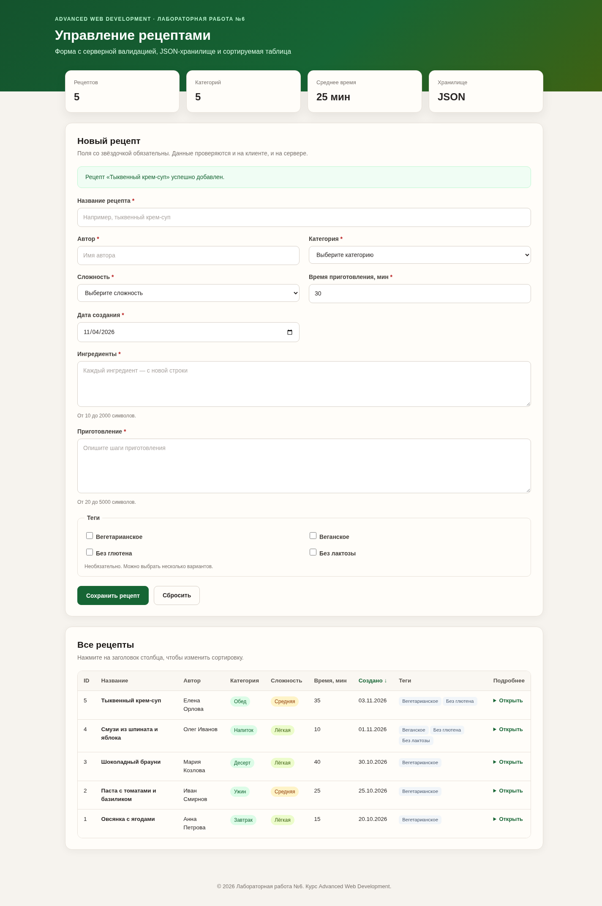
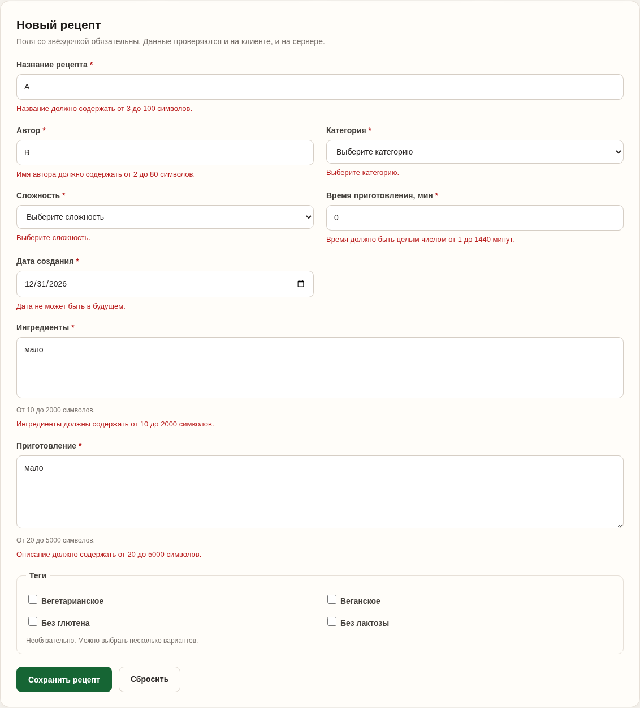

# Лабораторная работа №6. Обработка и валидация форм

## Цель работы

Освоить основные принципы работы с HTML-формами в PHP: отправку данных на сервер, их обработку, серверную валидацию и безопасный вывод. Дополнительно — применить объектно-ориентированный подход и интерфейсы для построения расширяемой архитектуры.

---

## Тема проекта

Выбрана тема **«Управление рецептами»**. Она позволяет естественно закрыть все требования к модели данных:

- есть строковые поля (название, автор);
- есть дата (дата создания);
- есть enum-поля с ограниченным набором значений (категория, сложность, теги);
- есть длинные текстовые поля (ингредиенты, инструкции);
- есть чекбоксы (теги).

В рамках работы реализованы добавление рецепта, сохранение в JSON, вывод в HTML-таблицу и сортировка по столбцам. Модель спроектирована так, чтобы позже можно было добавить редактирование и удаление записей.

---

## Структура проекта

```text
lab6/
├── index.php
├── data.json
├── main.md
├── image.png
├── image-1.png
├── image-2.png
└── src/
    ├── Recipe.php
    ├── RecipeOptions.php
    ├── ValidatorInterface.php
    ├── RecipeValidator.php
    ├── RecipeRepository.php
    ├── RecipeService.php
    ├── RecipeSorter.php
    ├── RecipeTableRenderer.php
    └── Validators/
        ├── RequiredValidator.php
        ├── LengthValidator.php
        ├── DateValidator.php
        ├── EnumValidator.php
        ├── IntegerRangeValidator.php
        └── TagsValidator.php
```

`index.php` выполняет роль контроллера: принимает запрос, вызывает сервис, показывает форму и таблицу. Бизнес-логика и валидация вынесены в классы.

---

## Шаг 1. Определение модели данных

Модель рецепта содержит 11 полей — больше минимально необходимых шести:

| Поле | Тип | Назначение | HTML-контрол | Валидация |
|:---|:---|:---|:---|:---|
| `id` | int | Уникальный идентификатор | — | Присваивается хранилищем |
| `title` | string | Название рецепта | `text` | Обязательно, 3–100 символов |
| `author` | string | Автор рецепта | `text` | Обязательно, 2–80 символов |
| `category` | enum | Категория блюда | `select` | Одно из: завтрак, обед, ужин, десерт, напиток |
| `difficulty` | enum | Сложность | `select` | Одно из: лёгкая, средняя, сложная |
| `prep_time` | int | Время приготовления, мин | `number` | Обязательно, целое от 1 до 1440 |
| `ingredients` | text | Список ингредиентов | `textarea` | Обязательно, 10–2000 символов |
| `instructions` | text | Пошаговое приготовление | `textarea` | Обязательно, 20–5000 символов |
| `tags` | array\<enum\> | Дополнительные теги | `checkbox` | Только значения из справочника |
| `created_at` | date | Дата создания | `date` | Обязательно, корректная дата не в будущем |
| `updated_at` | date | Дата обновления | — | Устанавливается автоматически |

Требования к модели выполнены: минимум 6 полей, есть `string` (`title`, `author`), `date` (`created_at`, `updated_at`), `enum` (`category`, `difficulty`, `tags`), `text` (`ingredients`, `instructions`) и группа чекбоксов для тегов.

Допустимые значения собраны в одном месте — классе `RecipeOptions`:

```php
final class RecipeOptions
{
    public const CATEGORIES = [
        'breakfast' => 'Завтрак',
        'lunch' => 'Обед',
        'dinner' => 'Ужин',
        'dessert' => 'Десерт',
        'drink' => 'Напиток',
    ];

    public const DIFFICULTIES = [
        'easy' => 'Лёгкая',
        'medium' => 'Средняя',
        'hard' => 'Сложная',
    ];

    public const TAGS = [
        'vegetarian' => 'Вегетарианское',
        'vegan' => 'Веганское',
        'gluten_free' => 'Без глютена',
        'lactose_free' => 'Без лактозы',
    ];
}
```

---

## Шаг 2. Создание HTML-формы

Форма отправляет данные методом `POST` на `index.php`. На клиенте используются стандартные атрибуты валидации, чтобы пользователь получал быструю обратную связь ещё до отправки:

```html
<form method="post" action="index.php?sort=created_at&amp;dir=desc">
    <input type="hidden" name="csrf_token" value="...">

    <input type="text" id="title" name="title"
           required minlength="3" maxlength="100">

    <select id="category" name="category" required>
        <option value="">Выберите категорию</option>
        <option value="breakfast">Завтрак</option>
        <option value="lunch">Обед</option>
        <!-- ... -->
    </select>

    <input type="number" id="prep_time" name="prep_time"
           required min="1" max="1440" step="1">

    <input type="date" id="created_at" name="created_at"
           required max="<?= date('Y-m-d') ?>">

    <textarea id="ingredients" name="ingredients"
              required minlength="10" maxlength="2000"></textarea>

    <textarea id="instructions" name="instructions"
              required minlength="20" maxlength="5000"></textarea>

    <label>
        <input type="checkbox" name="tags[]" value="vegetarian">
        Вегетарианское
    </label>
</form>
```

Что проверяется на клиенте:

- `required` — обязательные поля;
- `minlength` / `maxlength` — длина текста;
- `type="number"`, `min`, `max`, `step` — время приготовления;
- `type="date"`, `max` — дата не в будущем;
- `select required` — выбранное значение из списка;
- чекбоксы `tags[]` — необязательная группа тегов.

Клиентская валидация улучшает UX, но не заменяет серверную: её легко обойти, поэтому все те же правила повторно проверяются в PHP.

---

## Шаг 3. Обработка данных на сервере

Обработка построена по схеме:

1. `index.php` принимает `POST` и проверяет CSRF-токен.
2. `RecipeService` вызывает `RecipeValidator`.
3. `RecipeValidator` нормализует данные и прогоняет их через цепочку валидаторов.
4. При ошибках форма показывается снова с сохранёнными значениями и сообщениями.
5. При успехе `RecipeRepository` сохраняет рецепт в `data.json`, после чего выполняется редирект (PRG), чтобы форма не отправлялась повторно при обновлении страницы.

Фрагмент контроллера:

```php
if (($_SERVER['REQUEST_METHOD'] ?? 'GET') === 'POST') {
    $postedToken = (string) ($_POST['csrf_token'] ?? '');

    if (!hash_equals($csrfToken, $postedToken)) {
        $errors['form'] = 'Сессия истекла. Обновите страницу и попробуйте снова.';
    } else {
        $result = $service->create($_POST);

        if ($result['success'] && $result['recipe'] !== null) {
            $_SESSION['flash'] = 'Рецепт «' . $result['recipe']->getTitle() . '» успешно добавлен.';

            $query = http_build_query(['sort' => $sort, 'dir' => $direction]);
            header('Location: index.php?' . $query);
            exit;
        }

        $errors = $result['errors'];
        $formData = $result['data'];
    }
}
```

Валидация описана декларативно: каждому полю соответствует цепочка правил.

```php
$this->rules = [
    'title' => [
        new RequiredValidator('Укажите название рецепта.'),
        new LengthValidator(3, 100, 'Название должно содержать от 3 до 100 символов.'),
    ],
    'category' => [
        new RequiredValidator('Выберите категорию.'),
        new EnumValidator(array_keys(RecipeOptions::CATEGORIES), 'Выберите категорию из списка.'),
    ],
    'created_at' => [
        new RequiredValidator('Укажите дату создания.'),
        new DateValidator('Y-m-d', true, 'Укажите корректную дату не в будущем.'),
    ],
    // ... остальные поля
];
```

Сохранение в JSON выполняется с блокировкой файла и присвоением следующего ID:

```php
$handle = fopen($this->filePath, 'c+');
flock($handle, LOCK_EX);

$rows = $this->decodeRows(stream_get_contents($handle));
$storedRecipe = $recipe->withId($this->nextId($rows));
$rows[] = $storedRecipe->toArray();

$json = json_encode(
    $rows,
    JSON_PRETTY_PRINT | JSON_UNESCAPED_UNICODE | JSON_UNESCAPED_SLASHES | JSON_THROW_ON_ERROR
);

rewind($handle);
ftruncate($handle, 0);
fwrite($handle, $json . PHP_EOL);
fflush($handle);
flock($handle, LOCK_UN);
fclose($handle);
```

Пример сохранённой записи в `data.json`:

```json
{
    "id": 5,
    "title": "Тыквенный крем-суп",
    "author": "Елена Орлова",
    "category": "lunch",
    "difficulty": "medium",
    "prep_time": 35,
    "ingredients": "Тыква — 500 г\nСливки — 200 мл\nЛук — 1 шт.\nСпеции — по вкусу",
    "instructions": "1. Нарежьте тыкву и лук.\n2. Обжарьте овощи на масле.\n3. Добавьте воду и варите 20 минут.\n4. Измельчите блендером и добавьте сливки.",
    "tags": ["vegetarian", "gluten_free"],
    "created_at": "2026-11-03",
    "updated_at": "2026-11-04"
}
```

JSON выбран потому, что он остаётся читаемым для человека, легко парсится и хорошо подходит для учебного файлового хранилища.

---

## Шаг 4. Вывод данных и сортировка

`RecipeTableRenderer` формирует HTML-таблицу со столбцами:

- ID;
- название;
- автор;
- категория;
- сложность;
- время приготовления;
- дата создания;
- теги;
- подробности (ингредиенты и инструкция в раскрывающемся блоке `<details>`).

Все значения экранируются через `htmlspecialchars()`. Длинные тексты не ломают таблицу: они находятся в раскрывающемся блоке, а переносы строк преобразуются через `nl2br()` после экранирования.

Сортировка реализована через GET-параметры `sort` и `dir`:

```text
index.php?sort=category&dir=asc
index.php?sort=created_at&dir=desc
```

`RecipeSorter` проверяет поле по белому списку `FIELDS`, поэтому передать произвольное имя поля из URL нельзя. По умолчанию используется сортировка по дате создания от новых к старым. Повторный клик по заголовку меняет направление.

Таблица, отсортированная по категории:



---

## Шаг 5. Дополнительные функции (на 10 баллов)

Реализованы **оба** варианта дополнительных заданий.

### 1. Интерфейс для валидаторов

Все правила реализуют общий интерфейс:

```php
interface ValidatorInterface
{
    /**
     * @param mixed $value Проверяемое значение.
     * @return string|null Текст ошибки или null, если значение корректно.
     */
    public function validate(mixed $value): ?string;
}
```

Конкретные валидаторы:

- `RequiredValidator` — обязательность;
- `LengthValidator` — длина строки;
- `DateValidator` — формат даты и запрет будущего;
- `EnumValidator` — допустимый набор значений;
- `IntegerRangeValidator` — целое число в диапазоне;
- `TagsValidator` — допустимые теги.

`RecipeValidator` хранит цепочки правил и не знает, как именно устроен каждый валидатор. Чтобы добавить новую проверку, достаточно создать класс, реализующий `ValidatorInterface`, и добавить его в цепочку нужного поля. Это делает систему расширяемой и убирает дублирование условий.

### 2. ООП-реализация

Приложение разделено на классы с одной ответственностью:

| Класс | Ответственность |
|:---|:---|
| `Recipe` | Модель одной записи, неизменяемые данные, преобразование в массив и обратно |
| `RecipeOptions` | Справочники категорий, сложностей и тегов |
| `RecipeValidator` | Набор правил и нормализация данных формы |
| `RecipeRepository` | Чтение и запись `data.json`, блокировки, выдача ID |
| `RecipeService` | Сценарий создания рецепта: валидация + модель + сохранение |
| `RecipeSorter` | Сортировка коллекции по белому списку полей |
| `RecipeTableRenderer` | Только HTML-представление таблицы |

Зависимости передаются через конструкторы:

```php
$repository = new RecipeRepository(__DIR__ . '/data.json');
$validator = new RecipeValidator();
$service = new RecipeService($repository, $validator);
$sorter = new RecipeSorter();
$renderer = new RecipeTableRenderer();
```

Такой подход упрощает тестирование: репозиторий можно заменить на тестовый, а валидатор — на набор заглушек.

---

## Безопасность

В работе предусмотрены базовые меры защиты:

1. **XSS.** Все данные, попадающие в HTML, экранируются через `htmlspecialchars($value, ENT_QUOTES | ENT_SUBSTITUTE, 'UTF-8')`. В рендерере для этого есть отдельный метод `escape()`, в контроллере — функция `e()`.
2. **CSRF.** Форма содержит скрытый токен, который генерируется в сессии и проверяется через `hash_equals()`. POST без токена отклоняется.
3. **Серверная валидация.** Проверяются обязательность, длины, диапазоны, форматы дат и принадлежность значений справочникам. Клиентская валидация считается только подсказкой.
4. **Безопасная работа с файлом.** Используются `LOCK_EX`, `JSON_THROW_ON_ERROR` и проверка результата записи.
5. **Принцип PRG.** После успешного POST выполняется редирект, чтобы избежать повторной отправки формы.
6. **Ограничение вывода.** Данные в таблице экранируются, а не вставляются как готовый HTML.

В production-версии файл `data.json` стоило бы вынести за пределы webroot или закрыть к нему прямой доступ средствами веб-сервера, а также включить HTTPS и настроить параметры сессионной cookie (`HttpOnly`, `Secure`, `SameSite`).

---

## Результат работы

После отправки формы добавлен рецепт «Тыквенный крем-суп». На странице отображаются 5 рецептов, 5 категорий и среднее время приготовления 25 минут:



Пример серверной валидации: если обойти клиентские ограничения и отправить короткие поля, пустые select, нулевое время и будущую дату, сервер возвращает ошибки, а данные не сохраняются:



Сохранённые данные находятся в `data.json` в читаемом JSON-формате.

---

## Запуск проекта

```bash
php -S localhost:8000 -t lab6
```

Затем открыть `http://localhost:8000`.

Файл `data.json` должен быть доступен на запись пользователю, от имени которого работает PHP. Если файла нет, хранилище создаст его при первом добавлении.

---

## Контрольные вопросы

### 1. Какие существуют методы отправки данных из формы на сервер? Какие методы поддерживает HTML-форма?

Основные методы — `GET` и `POST`. HTML-форма поддерживает их через атрибут `method`; также в HTML5 есть `method="dialog"`, но он служит для закрытия диалогового окна, а не для обычной отправки данных на сервер.

**GET:**

- данные передаются в строке запроса (`?name=value`);
- видны в адресной строке, истории и логах;
- имеют ограничение по длине URL;
- подходят для поиска, фильтрации и сортировки;
- запрос идемпотентен: повторный GET не должен менять состояние сервера;
- результат можно добавить в закладки.

**POST:**

- данные передаются в теле запроса;
- не видны в URL;
- подходят для создания и изменения данных, а также для чувствительной информации;
- не имеют такого жёсткого ограничения по размеру, как GET (ограничение задаёт сервер);
- неидемпотентны: повторная отправка может создать новую запись;
- для форм с файлами используется `enctype="multipart/form-data"`.

В лабораторной работе для создания рецепта выбран `POST`, потому что форма изменяет состояние приложения и содержит длинные текстовые поля. Для сортировки используется `GET`, так как это безопасное чтение.

### 2. Какие глобальные переменные используются для доступа к данным формы в PHP?

В PHP данные формы приходят в суперглобальных массивах:

- `$_POST` — данные, отправленные методом POST (используется в этой работе);
- `$_GET` — параметры строки запроса (в работе — сортировка);
- `$_REQUEST` — объединяет GET, POST и Cookie; использовать его не рекомендуется из-за неоднозначности источника данных;
- `$_FILES` — загруженные файлы;
- `$_COOKIE` — cookie;
- `$_SESSION` — данные сессии (в работе — CSRF-токен и flash-сообщение);
- `$_SERVER` — информация о сервере и запросе (например, `REQUEST_METHOD`);
- `$_ENV` — переменные окружения.

Для доступа к отдельным значениям удобно использовать `filter_input(INPUT_POST, 'title', FILTER_DEFAULT)` или явно проверять наличие ключа через `$_POST['title'] ?? ''`. В коде не используется `$_REQUEST`, чтобы не смешивать источники данных.

### 3. Как обеспечить безопасность при обработке данных из формы (например, защититься от XSS)?

Главный принцип — **не доверять данным пользователя** и проверять их на сервере, даже если есть клиентская валидация.

Меры защиты:

1. **Валидация и нормализация.** Проверять обязательность, длины, диапазоны, форматы дат и допустимые значения enum. Использовать белые списки, а не чёрные.
2. **Экранирование вывода (XSS).** Перед вставкой в HTML применять `htmlspecialchars($value, ENT_QUOTES | ENT_SUBSTITUTE, 'UTF-8')`. Экранировать нужно в контексте вывода: для HTML — `htmlspecialchars`, для JavaScript — JSON-кодирование, для URL — `urlencode`. Не вставлять пользовательские строки в HTML без экранирования.
3. **CSRF-защита.** Генерировать случайный токен в сессии, добавлять его скрытым полем в форму и проверять через `hash_equals()` при POST. Дополнительно помогают cookie с `SameSite`.
4. **Защита от SQL-инъекций.** Если данные попадают в базу, использовать подготовленные запросы (PDO/MySQLi) и не склеивать SQL-строки с вводом. В этой работе базы нет, но принцип тот же: не подставлять ввод напрямую в исполняемые конструкции.
5. **Ограничение загрузки файлов.** Проверять MIME-тип, расширение, размер и хранить файлы вне webroot; не доверять имени файла.
6. **Безопасность сессий и транспорта.** HTTPS, `HttpOnly`, `Secure`, `SameSite` для cookie, `session_regenerate_id()` после аутентификации.
7. **Ограничение и логирование.** Задавать разумные лимиты длины, обрабатывать ошибки без вывода внутренних путей и стектрейсов пользователю.
8. **Хранение данных.** Файлы с данными не должны быть доступны по прямому URL; права доступа — минимально необходимые.

В лабораторной работе применены экранирование вывода, серверная валидация, CSRF-токен, проверка enum-значений и безопасная запись JSON с блокировкой файла.

---

## Вывод

В ходе лабораторной работы №6 я разработал приложение «Управление рецептами»: форму с методом POST и клиентской валидацией, серверную обработку с проверкой всех полей, JSON-хранилище с автоматическим присвоением ID, вывод в HTML-таблицу и сортировку по столбцам. Дополнительно я реализовал оба варианта на 10 баллов: интерфейс `ValidatorInterface` с набором переиспользуемых валидаторов и объектно-ориентированную архитектуру с разделением ответственности между моделью, сервисом, хранилищем, сортировщиком и рендерером.

Я закрепил навыки работы с `$_POST`, `$_GET`, `$_SESSION`, `DateTime`, JSON-файлами и экранированием вывода, а также убедился, что клиентская валидация должна обязательно дублироваться серверной.
